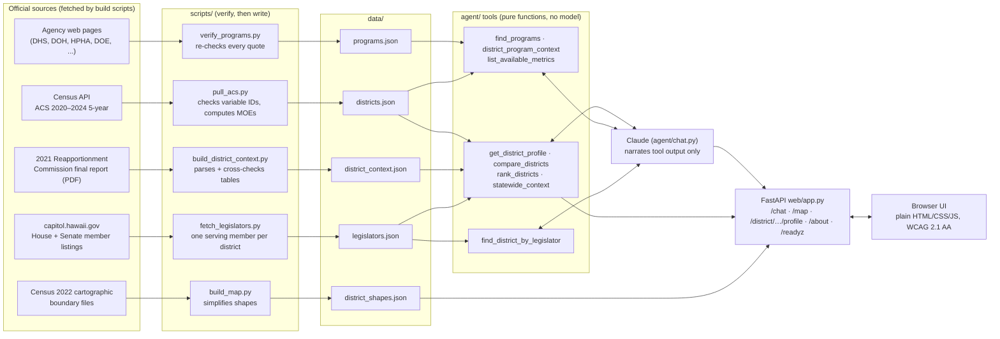

# Hawaiʻi District Profiles

An AI assistant that gives Hawaiʻi legislators and staff sourced, nonpartisan social and economic profiles of all 51 State House and 25 State Senate districts. Built for HAIC 2026.

- **Chat:** ask in plain language. Every figure comes from a data tool and is cited (source, table, year, boundary vintage), with caveats for low-reliability estimates.
- **District map:** shade districts by any measure, with a sortable table alternative. Select a district to ask about it.
- **One-page profiles:** a print-ready page for any district, including its serving legislator with source and fetch date, built straight from the data with no AI involved.
- **Assistance programs:** official facts about SNAP, Med-QUEST, WIC and others, framed as "may qualify, confirm with the agency".
- **Legislators:** which district a legislator represents, and who represents a district, from the member listings on capitol.hawaii.gov. Names are as written there; party is not recorded. Every legislator shown, in chat answers, under them in the UI, and on the one-page profile, comes with the note "as listed on capitol.hawaii.gov on November 10, 2026, before the Nov 3, 2026 general election results took effect". When a name isn't found, the answer says the roster may predate the election, not just "not found".
- **About:** `/about` explains the sources, the grounding guarantee and the limitations.

## Architecture



The model never reads the data files directly. It calls the tools, and the tools return values with their citations. The map and the one-page profiles bypass the model entirely.

## How grounding works

1. **Facts are built and verified before the model sees them.**
   - `pull_acs.py` confirms every Census variable ID against `variables.json`, fetches estimates with margins of error, and flags values where MOE / estimate > 30%.
   - `build_district_context.py` cross-checks every reapportionment figure in the PDF (island tables against statewide tables, sums against the stated totals) and leaves out anything that fails.
   - `verify_programs.py` re-fetches each agency page and confirms every quoted fact word for word.
2. **Tools return values, never prose.** Every value carries a citation and ready-formatted display strings, plus a caveat if it's low reliability. Any number a comparison needs is computed by the tool, so the model never does arithmetic: the ACS-vs-reapportionment population gap, confidence ranges, medians of districts.
3. **The system prompt forbids anything else.** The model may state only numbers from this turn's tool results. It must cite every figure, carry every caveat, never call someone eligible for a program, and say so when the data can't answer a question.
4. **Every answer is checked before it's shown** (`check_answer_runtime` in [agent/grounding.py](agent/grounding.py)):
   - every number in an answer must match a number in the tool results (rounding to the stated precision is allowed; numbers the user typed may be restated);
   - every low-reliability value stated must have its caveat next to it;
   - every program named must come from a tool result;
   - every legislator named must come from a tool result: any roster legislator named by first and last name, and any name after "Senator" or "Representative". Each must carry the roster's as-listed note;
   - no sentence may state eligibility as fact.
5. **Failed answers get one retry, then a visible warning.** `/chat` runs the check on every answer. If it fails, the model gets the specific problems once and is asked to fix them using only tool results; the rejected draft is removed from the conversation. If the second answer still fails, it is returned with `verified: false` and the list of problems, and the UI shows a "Not verified" warning above the answer. Every response carries `verification: {verified, numbers_checked, numbers_supported, retried, issues}`. A verified answer shows "✓ All N numbers verified against cited sources". Both results are text (not just color) and are announced by the page's live region.
6. **The live guardrail suite uses the same function**, plus question-specific checks. It caught the model computing a confidence range itself, which led to the tools providing `range_display`. The web layer also marks the low-reliability values an answer states, so the UI can flag them visibly.

## Run it

```
python -m venv .venv
.venv\Scripts\activate                 # macOS/Linux: source .venv/bin/activate
pip install -r requirements-dev.txt       # runtime + build scripts + tests, pinned (requirements.txt is runtime only)
python -m playwright install chromium  # only for the browser accessibility tests
```

Create `.env` in the repo root:

```
CENSUS_API_KEY=...       # only needed to rebuild data/districts.json
ANTHROPIC_API_KEY=...    # needed for chat
```

Start the web app:

```
uvicorn web.app:app --reload
```

Then open http://127.0.0.1:8000. You can also chat in a terminal with `python -m agent.chat`.

The data files are committed. To rebuild them from the sources:

```
python scripts/pull_acs.py                # verifies every variable ID first; the release year is ACS_YEAR at the top
python scripts/compare_acs.py             # old-vs-new report after changing releases (reports/acs_<old>_vs_<new>.json)
python scripts/build_district_context.py   # downloads the ~400 MB report, or pass --pdf PATH
python scripts/verify_programs.py          # re-verifies program quotes and stamps date_verified
python scripts/build_map.py
python scripts/fetch_legislators.py       # re-fetches the roster; fails unless every district has one serving member
```

## Configuration

All settings are environment variables (or `.env` locally). On Heroku, set them under **Settings → Config Vars**; see [DEPLOY.md](DEPLOY.md). Nothing secret is in the code or the repo.

| Variable | Default | Demo value | Meaning |
|---|---|---|---|
| `ANTHROPIC_API_KEY` | *(none)* | your key | Required for chat. Without it the map, profiles and `/about` still work and chat says it's unavailable. |
| `CHAT_MODEL` | `claude-sonnet-5-5` | `claude-sonnet-5-5` | Claude model for chat |
| `CHAT_EFFORT` | `medium` | `medium` | Reasoning effort (`low`, `medium`, `high`, `xhigh`, `max`) |
| `CHAT_MAX_TOKENS` | `8000` | `8000` | Max tokens per model response |
| `CHAT_MAX_TOOL_CALLS` | `10` | `10` | Tool calls allowed per question |
| `CHAT_SERVER_FALLBACK` | `1` | `1` | Retry on a fallback model if a safety filter declines (`0` to disable) |
| `RATE_LIMIT_PER_MINUTE` | `6` | `30` | Questions per client IP per minute. Raise it for the demo: everyone on a venue's wifi shares one IP. |
| `RATE_LIMIT_PER_DAY` | `150` | `600` | Questions per client IP per day (same shared-IP reason) |
| `RATE_LIMIT_GLOBAL_PER_MINUTE` | `30` | `60` | Questions per minute across all users; this is the cap on API spend |
| `RATE_LIMIT_GLOBAL_PER_DAY` | `500` | `500` | Questions per day across all users: a hard daily cap on API spend. When it's reached, chat says the demo has hit today's limit and points to the map, profiles and about page, which keep working. The 24-hour window slides; it doesn't reset at midnight. |
| `CHAT_MAX_CONCURRENT` | `4` | `4` | Questions processed at once (more get "busy, try again") |
| `CHAT_MAX_MESSAGES` | `20` | `20` | Questions plus answers per conversation (so 10 questions); then the user starts a new conversation |
| `SESSION_TTL_MINUTES` | `60` | `60` | A conversation held on the server expires after this many minutes without a question |
| `SESSION_MAX` | `200` | `200` | Conversations held in memory at once; when full, the least recently used idle one is dropped |
| `CHAT_MAX_MESSAGE_CHARS` | `2000` | `2000` | Max characters in one message |
| `CHAT_MAX_TOTAL_CHARS` | `20000` | `20000` | Max characters across all questions in one conversation |
| `ALLOWED_ORIGINS` | *(none)* | *(leave unset)* | Comma-separated origins allowed cross-origin access. The UI is served from the same origin, so it doesn't need this. |
| `TRUST_PROXY` | `0` | `1` | Set `1` behind exactly one reverse proxy you trust (Heroku's router), so rate limits apply per client. The app then uses the last `X-Forwarded-For` entry, which the proxy adds; earlier entries can be forged. |
| `PORT` | set by the host | *(set by Heroku)* | Port the web process binds to (`Procfile`). Locally, uvicorn defaults to 8000. |
| `CENSUS_API_KEY` | *(none)* | *(not needed)* | Only for `scripts/pull_acs.py` when rebuilding data |

Rate limits and conversations live in memory in one process, so the `Procfile` runs a single uvicorn worker. Don't scale to more than one dyno: each would keep its own limits.

## Deploy

Hosted on Heroku, one always-on **Basic** dyno. The GitHub Student Developer Pack's $13/month Heroku credit covers it, so it costs $0/month for 24 months. Step-by-step instructions, including where to paste the API key, are in [DEPLOY.md](DEPLOY.md). The repo has the files Heroku needs: `Procfile` (binds to `$PORT`, one worker), `.python-version` (3.12), a runtime-only `requirements.txt`, and `.slugignore`.

## Operations

- `GET /healthz`: liveness.
- `GET /readyz`: data loaded (district, context, program and map counts; program verification date; serving legislators and roster date), proxy mode, and whether chat is configured. `?deep=1` also checks that the AI service is reachable; this uses no tokens.
- **AI service down or out of credits:** the user sees a clear message ("temporarily unavailable…", "overloaded…") with links to the map and the about page, which still work. Upstream error text, keys and stack traces never reach the browser; details go to the server log with the request ID.
- **Request log:** each `/chat` request writes one JSON line to stdout (`"event":"chat"`): request ID (also the `X-Request-ID` response header), status and error code, latency in ms, session status and turn, tool calls and their names, verification result, and token counts: input, output, cache read and cache creation (totals, `cache_hit_ratio`, and an `api_calls` list with the same four counts for each model call). It never logs the question, the answer or tool inputs.
- **Prompt caching:** every model request has two cache breakpoints, the system prompt and the last block of the newest message (a question or a batch of tool results). Each call writes the conversation so far, and the next call in the same conversation (the tool round-trip or a follow-up question) reads it back, earlier tool results included, at the cache-read price. The marker is added when the request is sent and never stored, so the history never carries more than one. In the log, a healthy follow-up shows most of its prompt under `cache_read_input_tokens` and only the new turn under `cache_creation_input_tokens`. Cache entries last 5 minutes from their last use, so a follow-up asked after a longer pause pays to write the conversation again.
- **Daily cap:** `RATE_LIMIT_GLOBAL_PER_DAY` (default 500) stops chat for everyone once the day's questions are used, with a friendly message pointing to the map and profiles.
- **Conversations are held on the server.** The browser sends only a random session ID and its new question; it never sends earlier answers, so a client can't plant text in the model's history. Each session keeps the full conversation (including tool calls and tool results) in memory for 60 minutes without activity (`SESSION_TTL_MINUTES`), up to `SESSION_MAX` sessions. Grounding checks use every tool result from the session, so a follow-up can restate an earlier figure. Each answer's Sources panel lists the lookups made for it plus any earlier lookup in the conversation whose result supports a number or fact the answer states (a distinctive number, a legislator or a program; district numbers and years alone don't count), with its citations and source links, labelled "from an earlier lookup in this conversation". An unknown or expired session ID starts a new conversation, and the UI says so. A server restart ends all conversations.
- **Security:** the API key stays on the server. The pages run under a strict content security policy with no inline scripts. Model output is rendered with DOM APIs, never `innerHTML`.

## Data

| File | Source | Notes |
|---|---|---|
| `data/districts.json` | U.S. Census Bureau ACS 2020–2024 5-year, 2024 district boundaries | 12 measures per district: total population, median age, median household income, poverty rate, SNAP households (count and rate), renter cost burden, veterans (count and rate), Armed Forces (count and rate), limited-English households. Each has its MOE, table, variable IDs and source URL. |
| `data/district_context.json` | 2021 Reapportionment Commission Final Report and Plan (Office of Elections) | Areas covered (Appendix D) and permanent-resident population (Tables 1–10), with page citations. |
| `data/programs.json` | Official agency pages | 10 programs, every fact with a verbatim quote and verification date. |
| `data/district_shapes.json` | Census 2022 cartographic boundary files (from TIGER/Line) | Simplified to 73 KB. The Northwestern Hawaiian Islands are not drawn at map scale. |

| `data/legislators.json` | Hawaiʻi State Legislature member listings ([House](https://www.capitol.hawaii.gov/legislature/legislators.aspx?chamber=H), [Senate](https://www.capitol.hawaii.gov/legislature/legislators.aspx?chamber=S)), fetched 2026-11-10 (UTC) | Name as written on the site (party suffix removed), chamber, district, official profile URL, source URL, fetch date, and the site's own status text ("Appointed 08/09/2026", "Term of Office Ended: 06/30/2026"). The site says "(Showing Representatives/Senators for the 2026 regular session)" and doesn't mention the November 3, 2026 general election, so the file is marked **pre-election** membership. Two districts list a member whose term ended (House 28, Senate 18); they are kept with `serving: false`. No party affiliation. |
| `data/archive/districts_acs2023.json` | The previous release (ACS 2023 5-year, 2022 districts) | Kept for comparison; `reports/acs_2023_vs_2024.json` lists every value old vs new and the 31 low-reliability flags that changed (12 newly flagged, 19 no longer flagged). |

**Boundary vintage.** The Census Bureau lists the state legislative district vintage for the 2024 ACS as "2024 Legislative Session Year" ([Geography Boundaries by Year, 2024](https://www.census.gov/programs-surveys/acs/geography-acs/geography-boundaries-by-year.2024.html)), and for 5-year estimates says to "use the last year of the estimate period to determine the vintage." Its [2024 geography changes](https://www.census.gov/programs-surveys/acs/technical-documentation/table-and-geography-changes/2024/geography-changes.html) page does not list Hawaiʻi among the states with new plans and says all other states had no changes to their SLD boundaries from the 2022 cycle. The map still draws the 2022 cartographic boundary files.

Rates are computed from counts. Their MOEs use the Census Bureau's approximation formulas: the square root of summed squared MOEs for sums and differences, and the proportion formula for rates (falling back to the ratio formula when the proportion formula's radicand is negative).

## Tests

```
python -m pytest -m "not live"     # everything that doesn't call the AI service
python -m pytest -m live -s        # live guardrail suite (uses the API and costs tokens); reports p50/p95 latency per question
```

| Suite | What it checks |
|---|---|
| `test_legislators.py` | Roster only from capitol.hawaii.gov, no party, one serving member per district; every member found by name ignoring case/ʻokina/kahakō; shared names return candidates; no fuzzy matches; profile carries the legislator; name grounding check; the UI chip names a real legislator; the as-listed note travels with every legislator (tool results, /chat `roster_note`, one-pager, /about) and not-found says the roster may predate the election |
| `test_verification.py` | The runtime check (counts, each failure type), the one-retry loop in `/chat` (verified, fixed on retry, still failing, retry API error), and that `Agent.revise` drops the rejected draft from the history |
| `test_caching.py` | One moving `cache_control` marker on the last message of every request plus the system prompt's, never stored; each request starts with the previous request's messages (prefix stability); cache read and creation tokens per request and per API call in the log |
| `test_deploy.py` | Procfile binds `$PORT` on 0.0.0.0 with one worker; Python version pinned; runtime requirements only; every requirement pinned with `==` to the version the tests ran on; every env var the app reads is documented; a forged `X-Forwarded-For` can't dodge the rate limit |
| `test_acs_release.py` | Data matches the one `ACS_YEAR` constant; boundary vintage documented; the archived release and the comparison report agree with both files |
| `test_tools.py`, `test_context.py` | All 76 districts load; values match the data; invalid input returns an error, never a guess; every response is cited; display strings use consistent decimals |
| `test_grounding.py`, `test_programs.py` | The number, caveat, program and eligibility checkers; program data is official, quoted, and has no unquoted numbers |
| `test_web.py`, `test_hardening.py` | `/chat` with a mocked agent; server-held sessions (history comes from the server, expiry, LRU cap, client-sent history rejected, failed turns not saved); validation, rate limiting, key never exposed, AI-service failures, readiness, CORS, config, `/about` |
| `test_profile_page.py`, `test_map.py` | One-page profile built only from tool data; map data matches the tools |
| `test_a11y.py` | axe-core (WCAG 2.0/2.1 A/AA plus best practices) on every page and state; keyboard paths; focus rings; 200% zoom; 375px phone width; profile prints on one page |
| `test_chat_guardrails.py` (live) | Real questions on Sonnet; every number traced to tool results, caveats present, programs sourced, no eligibility claims |

Latest offline run: 411 passed. Reports are in [reports/](reports/): `a11y_report.json`, `guardrail_report.json` (the last live run, made on the ACS 2023 5-year data; re-scoring replays it against the archived file) and `acs_2023_vs_2024.json`.
